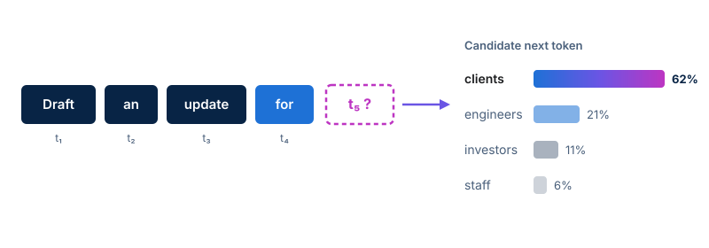

<!-- course-title: Prompt Engineering for Generative AI -->
<!-- course-theme: roi-alt-theme -->

<!-- layout: title -->


Prompt Engineering for Generative AI

# Chapter 1: Foundations of Prompt Engineering

---

# Chapter 1: Objectives

- Explain how large language models interpret instructions and assemble the core components of an effective prompt
- Describe how large language models predict tokens and respond to prompt context
- Combine persona, task, context, and constraints to build a clear prompt
- Control response structure and voice by specifying output format and tone
- Write and compare unstructured and structured prompts in Google Gemini

---

<!-- layout: navigation -->
# Chapter 1

- **How Large Language Models Interpret Prompts**
- The Anatomy of an Effective Prompt (Persona, Task, Context, Constraints)
- Specifying Output Format and Tone
- Lab: Writing Structured Prompts in Gemini

---

<!-- layout: stacked -->
# How Models Predict the Next Token

- Large language models generate responses one **token** (a word or word fragment) at a time
- Every word in your prompt shifts the probability of which token comes next
- The model does not know your unstated intent; it continues the pattern your prompt establishes



---

# The Context Window Is Working Memory

- The **context window** holds your current prompt, uploaded files, and the conversation history so far
- Gemini only uses information inside the current chat session unless you connect external tools
- Leaving out background facts forces the model to fill the gaps with statistical guesses
  - **Fix**: Paste the source notes, audience details, and rules directly into the prompt

> [!IMPORTANT]
> If a detail matters for the final answer, put it inside the prompt. The model cannot read your mind or your unshared documents.

---

# Do Now: Watch Gemini Fill in the Blanks

Try this in Gemini before we look at the fix.

- Open a new Gemini chat and run this exact one-line prompt:
  - `"Write an email about the project delay."`
- Write down three details Gemini invented on its own:
  - What caused the delay, when the new deadline is, and who receives the email
- Compare your output with another person in the room to see how the guesses differ

---

<!-- layout: 2-column -->
# Vague Prompts vs. Specific Context

### Vague Prompt
- `"Write an email about the project delay."`
- Forces the model to invent the project name, the cause, the new timeline, and the recipient
- Produces generic filler you have to rewrite from scratch

### Specific Prompt
- `"Write an email to a client explaining that website testing needs 3 extra days due to login bug fixes, moving launch to Friday."`
- Anchors the probability distribution to your real facts
- Produces a draft you can send with minor edits

---

<!-- layout: navigation -->
# Chapter 1

- How Large Language Models Interpret Prompts
- **The Anatomy of an Effective Prompt (Persona, Task, Context, Constraints)**
- Specifying Output Format and Tone
- Lab: Writing Structured Prompts in Gemini

---

<!-- layout: card-layout -->
# Four Building Blocks of a Strong Prompt

### Persona
- Define who the model is acting as to set expertise and perspective.
- Example: `"You are a senior customer support manager for a B2B software company."`

### Task
- State the exact action using a clear verb such as summarize, draft, compare, or extract.
- Example: `"Draft a reply to a customer asking to cancel their annual plan."`

### Context
- Supply the background facts, audience details, and source text the model needs.
- Example: `"The customer had two onboarding delays last month, and we can offer a 20% renewal credit."`

### Constraints
- Set clear boundaries such as length limits, must-include facts, and topics to avoid.
- Example: `"Keep it under 120 words and do not blame the engineering team."`

---

# Assembling a Structured Prompt

- Labeling each section helps you spot missing details before you press Enter
- Clear labels also help the model separate your instructions from your background data

```text
Persona: You are an IT security trainer writing for non-technical new hires.
Task: Explain why employees must use a password manager instead of reusing passwords.
Context: New hires complete onboarding in 15 minutes and feel overwhelmed by rules.
Constraints: Keep the explanation under 100 words, avoid security jargon like "credential stuffing," and end with one clear action step.
```

> [!NOTE]
> You can write these four building blocks as natural sentences or with explicit labels like `Persona:` and `Task:`. Explicit labels make it much easier to read, edit, and reuse your prompt later.

---

<!-- layout: 2-column -->
# When Constraints Are Missing

### Unbounded Request
- `"Explain how our 30-day return policy works."`
- Often returns a 400-word essay with invented shipping fees and generic legal disclaimers
- Requires heavy trimming before it fits a help-center snippet

### Constrained Request
- `"Summarize our 30-day return policy in 3 sentences using only the policy text below. Do not mention international shipping."`
- Caps the length and locks the model to your supplied text
- Prevents the model from adding policies you do not offer

<!-- below-columns -->

> [!TIP]
> State positive rules when possible (`"Use only the text below"`), and pair them with explicit exclusions (`"Do not mention pricing"`) when the model tends to wander.

---

<!-- layout: navigation -->
# Chapter 1

- How Large Language Models Interpret Prompts
- The Anatomy of an Effective Prompt (Persona, Task, Context, Constraints)
- **Specifying Output Format and Tone**
- Lab: Writing Structured Prompts in Gemini

---

<!-- layout: 3-column -->
# Choosing the Right Output Format

### Prose and Lists
- Executive summaries
- Email drafts and memos
- Bulleted action items with bold lead-ins

### Markdown Tables
- Side-by-side vendor or feature comparisons
- Project schedules with Owner, Task, and Due Date columns
- Risk registers and pros-and-cons matrices

### Structured Text
- JSON or CSV blocks for importing into spreadsheets
- Standardized templates with fixed headings
- Checklists with `[ ]` status boxes

---

# Specifying Tone and Reading Level

- **Tone** controls attitude and formality; **reading level** controls vocabulary and sentence complexity
- Avoid vague style words like `"make it good"` or `"sound nice"`
  - Pair two specific descriptors, such as `"direct and empathetic"` or `"formal and concise"`
- Name the target audience to calibrate technical depth automatically

```text
Format: Return a Markdown table with three columns: Feature, What Changed, and Customer Benefit.
Tone: Write in a warm, plain-language style aimed at small-business owners with no accounting background.
```

> [!WARNING]
> Combining conflicting tone instructions like `"be casual and conversational"` with `"use strict legal formality"` produces uneven, awkward phrasing.

---

# Demo: Reshaping One Response with Format and Tone

Watch how changing only the **Format** and **Tone** lines reshapes the same facts in Gemini.

- **Shared Context**: Release 2.4 adds single sign-on, faster CSV exports, and mobile receipt scanning
- **Run 1 (Executive Brief)**: Request a 3-bullet summary in a concise, formal tone for a chief information officer
- **Run 2 (Customer Guide)**: Request a 3-column Markdown table (`Feature`, `What Changed`, `How It Saves Time`) in a warm, plain-language tone
- Notice how the facts remain identical while the layout, vocabulary, and sentence structure shift completely

---

<!-- layout: navigation -->
# Chapter 1

- How Large Language Models Interpret Prompts
- The Anatomy of an Effective Prompt (Persona, Task, Context, Constraints)
- Specifying Output Format and Tone
- **Lab: Writing Structured Prompts in Gemini**

---

# Writing Structured Prompts in Gemini

Lab link: TODO

---

# What You Learned

- Explained how large language models interpret instructions and assembled the core components of an effective prompt
- Described how large language models predict tokens and respond to prompt context
- Combined persona, task, context, and constraints to build a clear prompt
- Controlled response structure and voice by specifying output format and tone
- Wrote and compared unstructured and structured prompts in Google Gemini

---

# Quiz 1 of 3

**Why does a vague prompt like “Write a summary of the Q3 meeting” often lead to invented details?**

- A. The model searches your private calendar and selects the wrong meeting
- B. The model predicts the most statistically likely next tokens when specific context is missing from the prompt
- C. Gemini only reads the first five words of any unstructured prompt
- D. Large language models require JSON formatting before they can summarize text

---

# Quiz 1: Answer

**Why does a vague prompt like “Write a summary of the Q3 meeting” often lead to invented details?**

**Correct: B.** The model predicts the most statistically likely next tokens when specific context is missing from the prompt

- Large language models generate text by predicting plausible next tokens based on patterns in their training data
- Without the actual meeting notes in the context window, the model fills in typical-sounding business topics
- Supplying the source notes and explicit constraints anchors the output to your real facts

---

# Quiz 2 of 3

**A coworker wants Gemini to compare three software tools by price, setup time, and support hours so the team can scan the differences quickly. Which prompt addition best controls the structure?**

- A. `"Act as an experienced chief technology officer."`
- B. `"Keep the tone friendly, upbeat, and encouraging."`
- C. `"Present the comparison as a Markdown table with columns for Tool, Monthly Price, Setup Time, and Support Hours."`
- D. `"Make sure the answer is thorough and easy to read."`

---

# Quiz 2: Answer

**A coworker wants Gemini to compare three software tools by price, setup time, and support hours so the team can scan the differences quickly. Which prompt addition best controls the structure?**

**Correct: C.** `"Present the comparison as a Markdown table with columns for Tool, Monthly Price, Setup Time, and Support Hours."`

- Naming the exact format (Markdown table) and the exact column headers removes guesswork
- Option A sets a **persona** and Option B sets a **tone**, neither of which guarantees a scannable table
- Option D (`"thorough and easy to read"`) is too vague and usually produces long paragraphs

---

<!-- layout: 2-column -->
# Quiz 3 of 3: Discussion

### Prompt
A manager types this prompt into Gemini: `"Write an announcement about our new hybrid work policy."` The response is 500 words long, sounds overly stiff, and states that employees can work from anywhere on Fridays - even though the company requires everyone in the office on Tuesdays, Wednesdays, and Fridays.

### Discuss
- Which of the four prompt building blocks (Persona, Task, Context, Constraints) are missing or incomplete?
- How would you rewrite this prompt, including format and tone, so the draft is accurate on the first try?

---

<!-- layout: 2-column -->
# Quiz 3: Discussion Points

**A manager types `"Write an announcement about our new hybrid work policy"` and gets an inaccurate, stiff, 500-word draft.**

### Strong Answers Mention
- **Missing Context**: Exact in-office days (Tuesday, Wednesday, Friday) and effective date were never provided
- **Missing Constraints**: Needs a word-count cap (for example, under 150 words) and a rule to use only the stated policy facts
- **Persona, Format, and Tone**: Specify an internal HR or leadership persona, a short email format with bulleted key dates, and a clear, supportive tone

### Watch For
- Blaming the model for “not knowing the company policy” when the facts were left out of the context window
- Rewriting the prompt with vague adjectives like `"make it shorter and nicer"` instead of concrete word limits and policy rules

---

# Questions and Answers

Questions?
