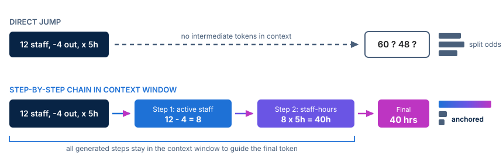

<!-- course-title: Prompt Engineering for Generative AI -->
<!-- course-theme: roi-alt-theme -->

<!-- layout: title -->


Prompt Engineering for Generative AI

# Chapter 2: Core Prompting Techniques

---

# Chapter 2: Objectives

- Guide model outputs and formatting using zero-shot, few-shot, and step-by-step prompting techniques
- Distinguish between zero-shot and few-shot prompting and choose when to use each
- Construct clear input-output examples that anchor model behavior and style
- Break complex problems into ordered steps to improve reasoning accuracy
- Apply few-shot examples and step-by-step decomposition to tasks in Google Gemini

---

<!-- layout: navigation -->
# Chapter 2

- **Zero-Shot vs. Few-Shot Prompting**
- Guiding Behavior with Examples
- Step-by-Step Reasoning and Task Decomposition
- Lab: Applying Few-Shot and Step-by-Step Prompting

---

<!-- layout: 3-column -->
# Zero-Shot, One-Shot, and Few-Shot Defined

### Zero-Shot
- Gives an instruction with **zero examples**
- Relies on patterns the model learned during training
- Best for everyday tasks like summarizing notes or drafting standard emails

### One-Shot
- Pairs an instruction with **one example**
- Shows the model a single template to copy
- Useful when you want the response to match a specific layout

### Few-Shot
- Pairs an instruction with **two to five examples**
- Establishes a repeatable pattern for labels, tone, and edge cases
- Essential for custom classification and strict formatting

---

# Why Few-Shot Beats Instructions Alone

- Describing a custom format or classification rule in prose often leaves room for interpretation
- A zero-shot prompt to tag support tickets may invent inconsistent labels like `"Urgent!"`, `"High Priority"`, or `"P1"`
- Providing a few input-output pairs locks the exact vocabulary and punctuation

```text
Classify each support message as Billing, Technical, or Account.

Message: "My credit card was charged twice for the May invoice."
Category: Billing

Message: "The export button freezes when I select more than 50 rows."
Category: Technical

Message: "Please update our company billing address and primary contact."
Category: Account

Message: "I cannot reset my two-factor authentication phone number."
Category:
```

---

<!-- layout: 2-column -->
# Choosing Zero-Shot vs. Few-Shot

### Start with Zero-Shot When
- You are brainstorming ideas, summarizing text, or drafting a one-off message
- Any clean, readable structure is acceptable
- You want a quick answer without gathering sample data first

### Switch to Few-Shot When
- The output must follow an exact house style, template, or label set
- Zero-shot replies keep adding unwanted introductions or varying the format
- Showing three short examples is faster than writing a paragraph of formatting rules

<!-- below-columns -->

> [!TIP]
> Start with a clear zero-shot prompt. If the model misses your exact structure or tone twice in a row, add two or three examples instead of piling on more adjectives.

---

<!-- layout: navigation -->
# Chapter 2

- Zero-Shot vs. Few-Shot Prompting
- **Guiding Behavior with Examples**
- Step-by-Step Reasoning and Task Decomposition
- Lab: Applying Few-Shot and Step-by-Step Prompting

---

<!-- layout: card-layout -->
# Building Effective Few-Shot Examples

### Consistent Labels
- Use the exact same markers, such as `Input:` and `Output:`, across every example.
- End your prompt with the new input followed by the output label so Gemini completes the pattern.

### Diverse Coverage
- Pick examples that represent the different categories or edge cases you expect to handle.
- Three varied examples teach boundaries much better than three nearly identical ones.

### Exact Formatting
- Format every sample output with the exact capitalization, punctuation, and length you want back.
- If your examples include extra conversational filler, the model will copy that filler too.

---

# Teaching Voice and Structure by Example

- Few-shot examples can teach tone, reading level, and structure at the same time
- Instead of describing how to rewrite technical release notes for customers, show two completed pairs

```text
Rewrite each engineering note into a one-sentence customer benefit starting with an action verb.

Engineering Note: Added Redis caching layer to reduce dashboard query latency by 65%.
Customer Update: Load your analytics dashboard in under a second, even on large date ranges.

Engineering Note: Enabled bulk CSV import with automatic duplicate email detection.
Customer Update: Import thousands of contacts at once without worrying about duplicate records.

Engineering Note: Upgraded PDF renderer to preserve custom brand fonts on exported invoices.
Customer Update:
```

---

<!-- layout: 2-column -->
# Common Few-Shot Pitfalls

### Skewed or Contradictory Examples
- Giving three `"Positive"` examples and zero `"Negative"` examples biases the model toward `"Positive"`
- Writing a rule that says `"Keep answers under 10 words"` while showing 25-word examples confuses the model
- Mixing different label styles (`Answer:`, `Result:`, `Output:`) weakens the pattern

### Balanced, Aligned Examples
- Include one example for each category or common edge case
- Audit every example to verify it obeys all length and style constraints in your instructions
- Keep the delimiter labels identical from the first example to the final prompt line

<!-- below-columns -->

> [!WARNING]
> When your examples conflict with your written instructions, the model almost always follows the pattern in the examples over the rule in the instructions.

---

<!-- layout: navigation -->
# Chapter 2

- Zero-Shot vs. Few-Shot Prompting
- Guiding Behavior with Examples
- **Step-by-Step Reasoning and Task Decomposition**
- Lab: Applying Few-Shot and Step-by-Step Prompting

---

<!-- layout: stacked -->
# Why Step-by-Step Reasoning Works

- Asking for an immediate final answer on a multi-step problem forces the model to guess across missing logic
- Prompting the model to **work step by step** writes intermediate reasoning tokens into the context window
- Each completed step stays in working memory and anchors the next token prediction



---

<!-- layout: 2-column -->
# Direct Leap vs. Step-by-Step Prompting

### Direct Leap (Error-Prone)
- `"A support team has 12 agents. 4 are out today. Each working agent works a 6-hour shift minus a 1-hour training session and resolves 3 tickets per working hour. How many tickets are resolved today? Return only the final number."`
- Prohibits intermediate work (`"Return only the final number"`)
- Frequently miscalculates because the model jumps straight to a single number token

### Step-by-Step Prompt (Reliable)
- `"Solve this problem step by step: 1) calculate active agents today, 2) calculate productive hours per agent, 3) calculate total tickets resolved across the team, and 4) state the final total on the last line."`
- Generates `12 - 4 = 8 agents` and `6 - 1 = 5 hours` before multiplying
- Makes the math easy for you to verify at a glance

---

# Task Decomposition for Complex Workflows

- **Task decomposition** breaks a large business request into an ordered list of smaller sub-tasks
- You can list numbered steps inside one prompt or run them one turn at a time in Gemini

```text
Analyze the customer survey responses below by completing these steps in order:
Step 1 - Extract every specific complaint mentioned and quote the exact phrase.
Step 2 - Group the extracted complaints into 3 recurring themes.
Step 3 - Draft one concrete action item for the product team under each theme.
```

> [!TIP]
> When Step 2 depends on getting Step 1 right, break the workflow into separate chat prompts so you can review and approve Step 1 before moving on.

---

<!-- layout: navigation -->
# Chapter 2

- Zero-Shot vs. Few-Shot Prompting
- Guiding Behavior with Examples
- Step-by-Step Reasoning and Task Decomposition
- **Lab: Applying Few-Shot and Step-by-Step Prompting**

---

# Applying Few-Shot and Step-by-Step Prompting

Lab link: TODO

---

# What You Learned

- Guided model outputs and formatting using zero-shot, few-shot, and step-by-step prompting techniques
- Distinguished between zero-shot and few-shot prompting and chose when to use each
- Constructed clear input-output examples that anchored model behavior and style
- Broke complex problems into ordered steps to improve reasoning accuracy
- Applied few-shot examples and step-by-step decomposition to tasks in Google Gemini

---

# Quiz 1 of 3

**You ask Gemini to classify incoming customer emails into three exact tags (`Refund`, `Bug`, or `Feature Request`), but your zero-shot prompt keeps returning full sentences and invented tags like `Billing Issue`. What is the most effective fix?**

- A. Repeat the instruction three times in all capital letters at the top of the prompt
- B. Add a few-shot block with 3 to 4 labeled `Email:` and `Tag:` examples before the new email
- C. Remove all context so the prompt is shorter
- D. Ask Gemini to write a creative story about customer support first

---

# Quiz 1: Answer

**You ask Gemini to classify incoming customer emails into three exact tags (`Refund`, `Bug`, or `Feature Request`), but your zero-shot prompt keeps returning full sentences and invented tags like `Billing Issue`. What is the most effective fix?**

**Correct: B.** Add a few-shot block with 3 to 4 labeled `Email:` and `Tag:` examples before the new email

- Few-shot examples demonstrate both the exact allowed label vocabulary and the single-tag output format
- Repeating instructions in all caps (Option A) does not show the pattern as clearly as concrete input-output pairs
- Removing context (Option C) or adding unrelated tasks (Option D) reduces classification accuracy

---

# Quiz 2 of 3

**Why does instructing a model to “solve this step by step” improve accuracy on multi-step calculations and logic problems?**

- A. It upgrades the chat session to a paid database connection
- B. It clears all previous messages from the context window
- C. Each intermediate step is written as tokens into the context window, anchoring the steps that follow
- D. It prevents the model from reading the constraints in your prompt

---

# Quiz 2: Answer

**Why does instructing a model to “solve this step by step” improve accuracy on multi-step calculations and logic problems?**

**Correct: C.** Each intermediate step is written as tokens into the context window, anchoring the steps that follow

- Large language models predict one token at a time based on the text already inside the context window
- Generating intermediate sub-results (such as headcount and hours) gives the model visible figures to use for the final calculation
- Asking for `"only the final number"` forces a single unanchored guess and hides arithmetic mistakes

---

<!-- layout: 2-column -->
# Quiz 3 of 3: Discussion

### Prompt
An operations analyst wants Gemini to review a 2-page vendor contract excerpt, check whether it violates 4 company purchasing rules, calculate the total first-year cost including setup fees and monthly seat licenses, and draft a 3-bullet approval memo for the finance director.

### Discuss
- Why is a single zero-shot prompt asking for just the final 3-bullet memo risky here?
- How would you decompose this request into ordered steps (or combine step-by-step reasoning with an example) to make the output verifiable?

---

<!-- layout: 2-column -->
# Quiz 3: Discussion Points

**An analyst needs a policy check, a multi-part cost calculation, and a 3-bullet approval memo from a vendor contract excerpt.**

### Strong Answers Mention
- **Risk of a direct leap**: Jumping straight to the 3-bullet summary hides whether the model miscalculated the seat math or overlooked one of the 4 purchasing rules
- **Step-by-step decomposition**: Step 1: Check each of the 4 rules against quoted contract clauses; Step 2: Show the itemized setup + monthly x 12 cost calculation; Step 3: Draft the 3-bullet memo using the verified numbers
- **Multi-turn or few-shot enhancement**: Running Steps 1 and 2 in a first prompt to verify accuracy, or providing a sample bullet to lock the memo format

### Watch For
- Adding `"Do not make any math mistakes"` without requiring the model to show the intermediate calculation steps
- Putting all the focus on tone and persona while skipping the step-by-step verification of the rules and numbers

---

# Questions and Answers

Questions?
